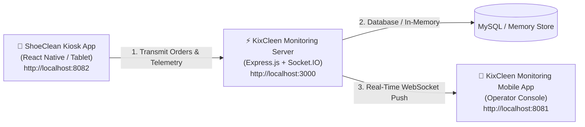

# 👟 KixCleen Monitoring & Telemetry Platform

A modern, real-time fleet operations and telemetry monitoring system built for **KixCleen Automated Shoe Cleaning Kiosks**. 

This system allows kiosk owners, floor operators, and managers to monitor live machine telemetry (ESP32 controllers, door locks, liquid water & foam reservoirs), track verified order revenues across GCash, Maya, and Cash, view 7-day revenue analytics, and receive real-time push notifications.

---

## 🏗️ System Architecture



- **Mobile Monitoring App** (`/mobile`): React Native (Expo SDK 58, Expo Router, TypeScript). Featuring a modern smoke-gray capsule bottom navigation bar (with 2x3 overflow dot grid), top notification popover, dark settlement hero card, 7-day revenue bar charts, and real-time Socket.IO listeners.
- **Backend API & Real-time Hub** (`/backend`): Node.js, Express.js, Socket.IO, JWT Authentication.
- **Kiosk Client (`shoeclean`)**: Customer-facing touch vending application that records orders and broadcasts hardware heartbeats directly to this monitoring server.

---

## 🚀 Quick Setup & Installation

### 1. Prerequisites
- **Node.js**: v18.x or v20.x installed ([Download Node.js](https://nodejs.org/))
- **npm** (included with Node.js)
- **Expo Go** app on your phone (if running on a physical Android or iOS device) or browser for web testing.
- Optional: MySQL / MariaDB (a zero-config in-memory database is built-in and works out-of-the-box).

---

### 2. Start the Monitoring Backend API

Open your terminal:

```bash
cd backend
npm install
npm run dev
```

The backend server will run on:
- **Local API**: `http://localhost:3000/api`
- **Socket.IO Server**: `http://localhost:3000`

> 💡 **Database Note**: If MySQL is not detected, the backend automatically uses an active in-memory store pre-seeded with operator accounts, kiosk chambers, and sample transactions.

---

### 3. Start the Monitoring Mobile App

In a second terminal:

```bash
cd mobile
npm install
npx expo start
```

Press:
- `a` — Open in Android emulator or connected device via ADB
- `i` — Open in iOS simulator
- `w` — Open in Web browser (Chrome / Edge)
- Or scan the QR code using the **Expo Go** app on your physical phone!

---

## 🔗 How to Connect KixCleen Monitoring to `shoeclean`

The customer kiosk app (`shoeclean`) and this monitoring system communicate seamlessly over local network HTTP and WebSockets.

### Step 1: Configure `shoeclean` Environment

In your `shoeclean` project root, make sure `.env` points to the monitoring server:

```env
# shoeclean/.env
EXPO_PUBLIC_MONITOR_API_URL=http://localhost:3000/api
EXPO_PUBLIC_KIOSK_ID=KIOSK-01-MAIN
```

> 📲 **Testing on Physical Devices over Local Wi-Fi**:
> If running either app on a physical phone/tablet connected to the same Wi-Fi, replace `localhost` with your computer's local IP address (e.g. `192.168.1.15`):
> ```env
> EXPO_PUBLIC_MONITOR_API_URL=http://192.168.1.15:3000/api
> ```
> And in `mobile/.env`:
> ```env
> EXPO_PUBLIC_API_URL=http://192.168.1.15:3000/api
> EXPO_PUBLIC_SOCKET_URL=http://192.168.1.15:3000
> ```

---

### Step 2: Start `shoeclean`

In a third terminal:

```bash
cd c:\Users\PEKTO_Song\Desktop\shoeclean
npm install
npx expo start
```

---

### Step 3: Test the Live Connection

1. On the **`shoeclean` kiosk**:
   - Pick a shoe type (e.g. *Sneakers*) and service (e.g. *Deep Clean - ₱150*).
   - Select payment (Cash, GCash, or Maya).
   - Simulate or complete the payment.
2. Observe the **KixCleen Monitoring App**:
   - **Instant Notification**: A live order notification popover updates immediately.
   - **Revenue Update**: Today's Settled Revenue increases in real-time.
   - **Recent Orders**: The new order `#KIX-YYYYMMDD-XXXX` appears automatically at the top of the 6 recent orders list!
   - **Cleaning Cycle & Door Status**: As the kiosk transitions into the wash cycle, the Chamber Door lock status turns **Locked**, and the live activity shows the cleaning step percentage!

---

## 🔐 Operator Login Credentials

Log in to the monitoring app with either of these accounts:

| Role | Username | Password | Privileges |
| :--- | :--- | :--- | :--- |
| **Admin** | `admin` | `admin1234` | Live orders, machine refill telemetry, door unlock controls |
| **Owner** | `owner` | `admin1234` | Full financial settlements, revenue channels, reports & analytics |

---

## 📱 Navigation & Features

- **Dashboard**:
  - Unified header with top-anchored live notification popover.
  - Dark settlement hero card showing today's collected volume and breakdowns.
  - Live reservoir pills (Water %, Soap %, Chamber Door status).
  - 7-day revenue trend bar chart.
  - Recent orders stream (displays the latest 6 transactions).
- **Orders (`/transactions`)**: Search, filter, and audit all incoming kiosk transactions with receipt breakdowns.
- **Payments (`/payments`)**: Settlement ledger by payment channel (GCash, Maya, Cash slots).
- **Telemetry (`/machine`)**: Detailed ESP32 diagnostics, chamber controls, and reservoir refills.
- **Bottom Navigation**: Custom matte smoke-gray capsule with a **2x3 horizontal six-dot grid** overflow button that opens **Reports & Analytics** and **Settings**.

---

## 🛠️ Hardware Simulation Scripts

To test live telemetry and simulate vending machine sensor updates without running the physical kiosk hardware:

```bash
cd backend
npm run simulate
```

This simulates random sensor heartbeats, reservoir depletion, and automated kiosk orders over Socket.IO.
